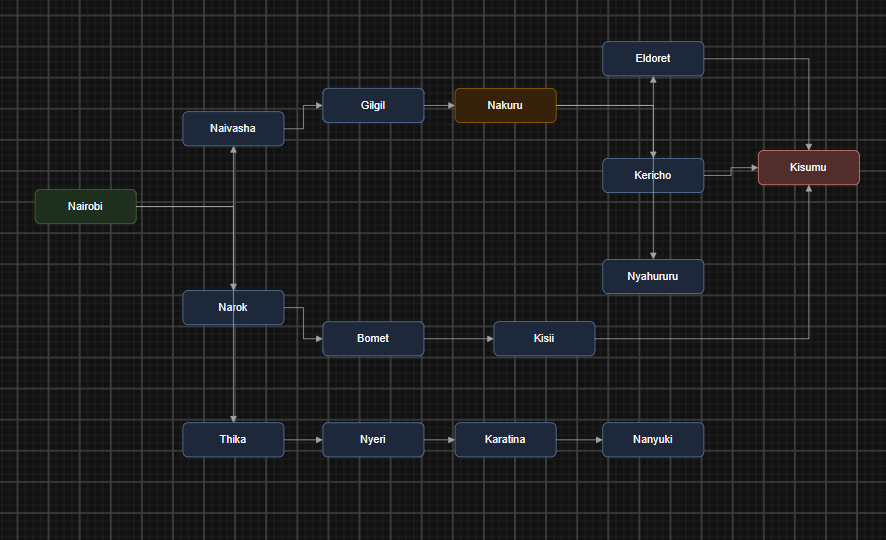

## number 1
Performance measure -to reach kisumu using the lowest path cost while following the highway network and avoiding unecessary routes
Environment-Kenya's highway network consisting of towns and roads connecting them
Actuators-Steering,accelerator,brakes,indicators
Sensors-GPS,cameras,road sensor,speed sensor

Defining environment
partially observavble-The trailer doesn't have complete info about it's environment and has to make informed judgements based on the little info
Stochastic-The result oof travelling is't completely predictable due ot traffic,weather ,accidents and road conditions
Sequential-The environment has variety of aspects beyond control of the agents
Dynamic-the environment can change while agent is selecting an action making the agent consult the environment before acting

## number 2

1. Directed graph
Kenya’s highway network is represented as a directed graph \(G=(V,E)\), where vertices (\(V\)) represent towns and cities, while edges (\(E\)) represent road connections. The network covers the Nairobi, Central Highlands, Rift Valley and Lake Victoria Basin regions.

The agent uses the graph to identify possible routes from Nairobi to Kisumu. Road connections can be assigned costs based on distance, traffic or travel time to compare alternative routes.

2. Search tree using abstraction
Abstraction simplifies the search by grouping towns into major travel corridors before expanding promising routes into individual towns. This reduces the complexity of searching the entire highway network.

For example, the agent can explore the route Nairobi → Naivasha → Gilgil → Nakuru → Kericho → Kisumu. It can use A* search to select a suitable route based on the cost already travelled and the estimated remaining cost to the destination.
